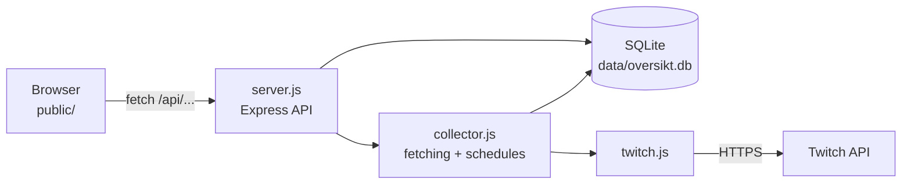

# Översikt

Översikt is a web app that tracks Twitch streams. It collects viewer numbers and followers from the Twitch API while a channel is live, stores them in a local database, and shows the results per stream, week, weekday and category.

It was built as a school assignment (2026). It runs on your own computer: a small Node.js server talks to Twitch, and you use the app in your browser.

## Contents

- [Features](#features)
- [Requirements](#requirements)
- [Getting started](#getting-started)
- [Getting your Twitch keys](#getting-your-twitch-keys)
- [Settings (.env)](#settings-env)
- [How data is collected](#how-data-collected)
- [What the numbers mean](#what-the-numbers-mean)
- [How the app is built](#how-the-app-is-built)
- [Design system](#design-system)
- [Accessibility](#accessibility)
- [Security](#security)
- [Troubleshooting](#troubleshooting)
- [Known limitations](#known-limitations)

## Features

- Search for any Twitch user and bookmark the ones you want to follow.
- **Overview:** status, followers, bio and the top three categories of the last 30 days. Click a category to open it in 30 Days.
- **30 Days:** filter by category; see summary figures, a chart and every stream.
- **Weekly:** step back up to 12 weeks and compare each week with the one before.
- **Charts on 30 Days and Weekly:** one bar chart per page with a checkbox for each figure (max viewers, average viewers, followers gained, hours watched). Each figure has its own colour, chosen for WCAG AA contrast and colour-blind safety. Hover, tap or use the arrow keys to read each day: the info box shows the date, the categories streamed that day with their picture, and each ticked figure. Numbers of 1,000 and above are shortened in charts (1k, 1.5k, 2k).
- **Day:** pick a weekday the user streams on and see the latest stream, or the past 4 or 12 of that weekday. The latest stream has a timeline chart: viewers as a line and new followers per 5 minutes as bars, each with a checkbox to show or hide it. Hover, tap or use the arrow keys on the chart to read the time, viewers and new followers at each point.
- Export what you're looking at as a CSV file for Excel or Google Sheets.
- Light and dark mode, a choice of accent colour, and support for keyboard and screen reader use.
- Browser back/forward and the address bar follow where you are in the app, so pages can be bookmarked.

## Requirements

| What | Version | How to check |
| --- | --- | --- |
| [Node.js](https://nodejs.org/) | 22.13 or newer (the LTS version is fine) | `node -v` |
| npm | Comes with Node.js | `npm -v` |
| A Twitch account | Free | – |
| A modern browser | Chrome, Edge, Firefox or Safari | – |

You don't need to install a database. The app uses the SQLite database built into Node.js, so nothing has to be compiled during installation.

## Getting started

**1. Get the code**

```bash
git clone https://github.com/<your-username>/oversikt.git
cd oversikt
```

**2. Install the dependencies**

```bash
npm install
```

**3. Create your settings file**

Copy the template:

```bash
# macOS / Linux
cp .env.example .env

# Windows (Command Prompt or PowerShell)
copy .env.example .env
```

Then open `.env` and paste in your Twitch Client ID and Client Secret. See [Getting your Twitch keys](#getting-your-twitch-keys).

**4. Start the server**

```bash
npm start
```

You should see:

```
Översikt: http://localhost:3000
Daily fetch at 20:00
```

Node.js may also print `ExperimentalWarning: SQLite is an experimental feature`. That's harmless.

**5. Open the app**

Go to <http://localhost:3000> in your browser. Search for a Twitch username to get started.

To stop the server, press `Ctrl + C` in the terminal.

## Getting your Twitch keys

The app needs a Client ID and a Client Secret to use the Twitch API. Both are free.

1. Go to the [Twitch Developer Console](https://dev.twitch.tv/console) and log in. Twitch may ask you to turn on two-factor authentication first.
2. Choose **Applications** → **Register Your Application**.
3. Fill in the form:
   - **Name:** anything unique, for example `oversikt-yourname`.
   - **OAuth Redirect URLs:** `http://localhost:3000`. The app doesn't use it, but the form requires one.
   - **Category:** pick the closest match, for example *Analytics Tool*.
   - **Client Type:** *Confidential*.
4. Save, then click **Manage** on your new application.
5. Copy the **Client ID** into `TWITCH_CLIENT_ID` in `.env`.
6. Click **New Secret** and copy it into `TWITCH_CLIENT_SECRET`.

> **Keep the secret secret.** Never commit `.env`, paste it in an issue or share it with anyone. `.env` is already listed in `.gitignore`. If it leaks, create a new secret in the console.

## Settings (.env)

| Setting | Default | What it does |
| --- | --- | --- |
| `TWITCH_CLIENT_ID` | – | Your Twitch Client ID. **Required.** |
| `TWITCH_CLIENT_SECRET` | – | Your Twitch Client Secret. **Required.** |
| `PORT` | `3000` | The port the app runs on: `http://localhost:PORT` |
| `HOST` | `127.0.0.1` | Who can reach the server. `127.0.0.1` means only your own computer. Use `0.0.0.0` only when hosting it somewhere (see [Security](#security)). |
| `DAILY_FETCH_TIME` | `20:00` | Time of day (24h, the server's time zone) when all bookmarked users are fetched. |
| `LIVE_POLL_MINUTES` | `0` | How often, in minutes, to measure bookmarked users who are live. `0` turns it off. **Set this to `5` (or lower) to get real viewer numbers.** |

Restart the server after changing `.env`.

<a id="how-data-collected"></a>
## How data is collected (important)

The Twitch API only tells you how many people are watching **right now**. It has no history of past viewer numbers. So the app builds its own history: it measures streams while they're live and saves every measurement.

**That means the server has to be running while the stream is live.** Streams that happened while the server was off have no viewer numbers, and they can't be fetched afterwards.

| When | What happens |
| --- | --- |
| You search for a user for the first time | Their profile is fetched and saved |
| You press **Fetch new data** | The user is fetched now and saved |
| Every day at `DAILY_FETCH_TIME` | All bookmarked users are fetched. If the server was off at that time, it catches up when it starts. |
| Every `LIVE_POLL_MINUTES` minutes | Viewer count, category and follower count are saved for every bookmarked user who is live |

Each fetch saves the profile, the follower count and the list of past broadcasts (VODs, used for exact stream lengths). If the user is live at that moment, it also saves a measurement.

**Recommended setup to track your own channel:**

1. Set `LIVE_POLL_MINUTES=5` in `.env`.
2. Search for your channel in the app and bookmark it.
3. Start the server (`npm start`) before you go live, and stop it after the stream.

Only streams with at least one measurement appear in the app.

## What the numbers mean

| Metric | How it's calculated |
| --- | --- |
| Max viewers | The highest viewer count measured during the stream |
| Avg viewers | The average of all measurements during the stream |
| Followers gained | Followers at the last measurement minus followers at the first. Needs at least two measurements. |
| Hours watched | Average viewers × stream length in hours |
| Median max viewers | The middle value of Max viewers across the streams shown |
| Comparison (+/−) | The same figure for the period before, for example the week before |

The more often the server measures, the more accurate Max and Avg viewers become. A short peak between two measurements isn't captured.

## How the app is built



The browser never talks to Twitch directly. It only calls this app's own API, so the Twitch keys stay on the server.

### Files

```
oversikt/
├── server.js          Web server, security settings and the API the browser calls
├── collector.js       Fetches data from Twitch, saves it, and runs the daily and live schedules
├── twitch.js          All calls to the Twitch API, including getting and renewing the access token
├── db.js              Creates the SQLite database and its tables
├── public/            Everything the browser loads
│   ├── index.html     The page skeleton
│   ├── theme.js       Picks light or dark mode before the page is drawn
│   ├── style.css      All styling, with the design tokens at the top
│   └── app.js         The app itself (state, rendering, actions, navigation)
├── .env.example       Template for your settings
├── package.json       Dependencies and the start script
└── data/              The database file (created on first start, not committed)
```

### Backend

- **Dependencies:** [Express](https://expressjs.com/) for the web server and [dotenv](https://github.com/motdotla/dotenv) to read `.env`.
- **Twitch authentication:** `twitch.js` exchanges the Client ID and Secret for an *app access token*. It renews the token automatically, and every call to Twitch times out after 10 seconds.
- **Twitch endpoints used:** Get Users, Get Streams, Get Channel Followers, Get Videos and Get Games.

**API** (used by the browser):

| Request | What it does |
| --- | --- |
| `GET /api/users` | Bookmarked users |
| `GET /api/users/:login` | Saved profile of a user |
| `GET /api/users/:login/streams` | The user's streams with calculated figures (last 200 days) |
| `GET /api/users/:login/streams/:id/timeline` | Every measurement during one stream |
| `POST /api/users/:login/fetch` | Fetch the user from Twitch now and save |
| `PUT /api/users/:login/saved` | Bookmark or un-bookmark: `{ "saved": true }` |

**Database tables** (`db.js`):

| Table | Contains |
| --- | --- |
| `users` | Profile, bookmark flag and when the user was last fetched |
| `snapshots` | One row per measurement: time, viewers, category, title and followers |
| `vods` | Past broadcasts from Twitch, used for exact stream length |
| `follower_counts` | Follower count per user per day |
| `categories` | Category name and the link to its picture on Twitch |

Per-stream figures aren't stored. They're calculated from `snapshots` with SQL each time they're requested, so deleting or editing a measurement changes the figures straight away.

To look inside the database, open `data/oversikt.db` with a tool such as [DB Browser for SQLite](https://sqlitebrowser.org/). Stop the server before you edit anything, and copy the `.db-wal` and `.db-shm` files along with the `.db` file if you move it.

### Frontend

The frontend is plain HTML, CSS and JavaScript, with no framework and no build step. `public/app.js` is split into numbered sections:

| Section | What it does |
| --- | --- |
| 1. Data source | `DataSource`: every call to the backend API |
| 2. State + storage | `S`, the app's state, plus accent colour and light/dark mode |
| 3. Helpers | Formatting, maths, icons |
| 4. Filtering | `period()`: which streams each tab shows and what they're compared with |
| 5. Rendering | Functions that turn the state into HTML; `render()` redraws the page |
| 6. Actions | Clicks, keyboard handling, the colour picker, history and CSV export |
| 7. Start | Reads the address bar and opens the right page |

**How it works:**

- **State to HTML:** every action changes `S` and calls `render()`, which rebuilds the page from `S`.
- **`data-a` attributes** name the action a click triggers. One click listener at the bottom of `app.js` handles them all.
- **`data-k` attributes** are stable keys that let `render()` put keyboard focus back on the same element after redrawing.
- **The address bar** reflects the state, for example `/?user=name&tab=day&day=fri&range=latest`. Opening a user, going to start and switching tab add a browser history step. Filters update the current step.
- **Text safety:** all text from Twitch goes through `esc()` before it's put into the HTML.

## Design system

All spacing, font sizes, fonts and colours are CSS variables at the top of `public/style.css`. Change a variable there and it changes everywhere.

**Spacing (4-point system)**, used for margin, padding and gap:

| Token | Value |
| --- | --- |
| `--space-xs` | 4px |
| `--space-s` | 8px |
| `--space-m` | 16px |
| `--space-l` | 24px |
| `--space-xl` | 32px |
| `--space-xxl` | 48px |

`--divider` (2px) is the thin line between tabs and table cells.

**Type**

| Token | Size | Used for |
| --- | --- | --- |
| `--text-sub` | 14px | Subtext: tabs, labels, small figures |
| `--text-body` | 16px | Body text and card titles |
| `--text-head` | 24px | Headings, usernames, status and followers |
| `--text-big` | 34px | Big figures in the summary |

| Token | Font | Used for |
| --- | --- | --- |
| `--font-title` | Lexend | Titles, headings and subtext |
| `--font-body` | Nunito | Body text |

**Chart colours.** `--series-1` to `--series-4` are the bar colours for the four figures, based on the colour-blind-safe Okabe-Ito palette, with one set per mode. Each has at least 4.5:1 contrast against the chart background.

**Colour.** The brand palette (Onyx, Dust grey, Grey, Shadow grey) is mapped to roles such as `--bg`, `--surface`, `--text` and `--text-muted`, with one set for dark mode and one for light mode. The accent colour is chosen by the user. `setAccent()` in `app.js` sets one `--accent` per mode: the chosen colour itself, made only as much darker (light mode) or lighter (dark mode) as needed to reach 3:1 contrast against the page and the surfaces. Strong colours usually stay exactly as chosen. `--on-accent` is the text colour on top of it, with at least 4.5:1. Small text is never drawn in the accent colour, so 3:1 is enough.

## Accessibility

The app aims to meet **WCAG 2.1 AA**.

- **Keyboard:** everything works with Tab, Enter, Space and Escape. The colour picker keeps focus inside it while it's open, and returns focus to the palette button when it closes.
- **Contrast:** text has at least 4.5:1 contrast, and large text, icons and chart marks at least 3:1, in both light and dark mode. The accent colour keeps the colour the user chose, and is only darkened (light mode) or lightened (dark mode) when needed to reach that.
- **Light/dark mode** follows the system setting when the page opens and can be switched with the button in the top right.
- **Screen readers:** the page has a main heading, the page tabs are navigation with `aria-current`, colours have names and charts have a text description.

## Security

- **Keys:** the Twitch keys are only in `.env` and only used on the server.
- **Who can reach it:** the server only accepts connections from your own computer (`HOST=127.0.0.1`), and only requests addressed to `localhost` (protection against DNS rebinding).
- **Other websites:** changes (`POST`, `PUT`) coming from another website are refused.
- **Content Security Policy:** only allows scripts from the app itself and images from Twitch's image server.
- **Input checks:** usernames and other input are validated, and all database queries are parameterised.
- **Rate limits:** the same user can be fetched on demand at most every 20 seconds, with at most 10 fetches per minute in total.
- **Error messages** never show code or stack traces to the browser.
- **CSV export:** cells that start with `=`, `+`, `-` or `@` are written as text, so spreadsheets don't run them as formulas.

> **There is no login.** If you set `HOST=0.0.0.0` (needed on hosting services), anyone who finds the address can use the app and trigger fetches from Twitch with your keys. Only do that if you add your own protection.

## Troubleshooting

| Problem | Solution |
| --- | --- |
| `npm install` fails, or `node:sqlite` isn't found | Your Node.js is too old. Check with `node -v` and install 22.13 or newer. |
| `ExperimentalWarning: SQLite is an experimental feature` | Harmless. It's a notice from Node.js; the app works normally. |
| `EADDRINUSE` when starting | Something else is using the port. Close it, or change `PORT` in `.env`. |
| `Twitch did not accept the keys in .env` | Check `TWITCH_CLIENT_ID` and `TWITCH_CLIENT_SECRET`: no spaces or quotes. Create a new secret if needed. |
| `No Twitch keys in .env yet: automatic fetching is off.` | `.env` is missing or has no keys. See [Getting started](#getting-started). |
| A user has no streams | Streams only appear once the server has measured them live. See [How data is collected](#how-data-collected). |
| `Forbidden` in the browser | Open the app via `http://localhost:3000` or `http://127.0.0.1:3000`, not your computer's name or IP. |
| The page looks out of date after an update | Reload without cache: `Ctrl + F5` (Windows) or `Cmd + Shift + R` (Mac). |

## Known limitations

- **Unique viewers can't be shown.** The Twitch API doesn't say who is watching, only how many, so unique viewers, live views and unique chatters are left out.
- **History starts when you start the server.** Viewer numbers only exist for streams the server measured while they were live.
- **Accuracy depends on polling.** Max and average viewers are only as accurate as the measuring interval (`LIVE_POLL_MINUTES`).
- **Late starts:** if the server starts partway through a stream, followers gained is only counted from the first measurement.
